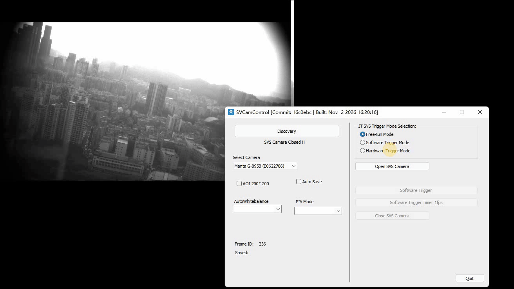
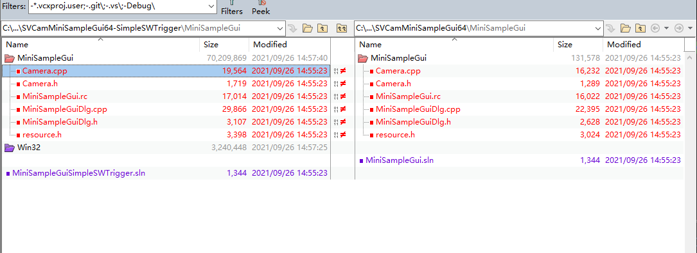

# svs_sw_trigger_auto_test
Based on SVCamMiniSampleGui64, Implement automatically software trigger testing loop and photo saving.
Implement modes switching among:  
1. FreeRun  
2. Software trigger  
3. Hardware trigger 

## Environments
1. SVCapture 2.5.6 and later
2. Visual Studio 2019 Community / Visual Studio 2022 Community
3. ...

## Screenshot

## Modification
Original example: `SVCamMiniSampleGui64`  
Modified example (C++ MFC): `SVCamMiniSampleGui64-SimpleSWTrigger`  
Modified example (C# .NET): `SVCamMiniSampleGui64-SimpleSWTrigger.NET`  

## Histroy
1. 2026/11/02, Manta G895 Passed;
2. 2026/11/04, Added C# clone `SVCamMiniSampleGui64-SimpleSWTrigger.NET` based on SVS .NET/C# SDK;
